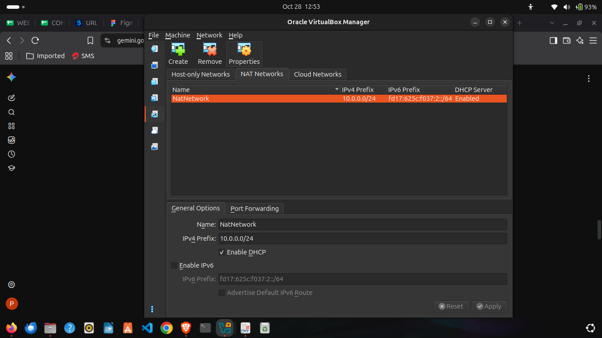
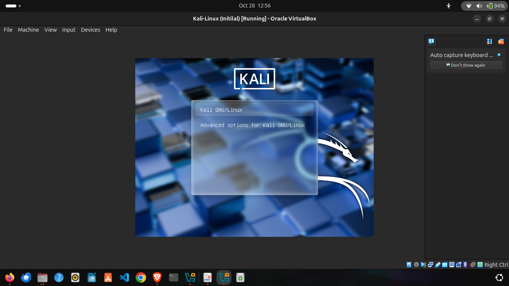
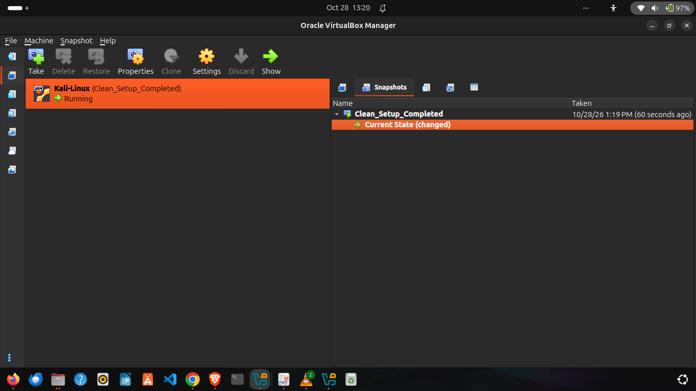

<div align="center">

# 🔐 Cybersecurity Lab Environment Setup (Ubuntu Host)

**Building an isolated virtual lab for penetration testing and ethical hacking practice**
</div>

<p align="center">
  
  
  
  
  
</p>

---

## 📌 Project Overview

This project documents the installation and configuration of a **virtual cybersecurity laboratory** using VirtualBox on an **Ubuntu Linux host system**. 

The goal is to build an isolated, reproducible testing environment where security tools, vulnerability assessments, and network scanning can be executed safely without impacting the host or external networks.

---

## 🎯 Objectives

- Configure a custom **NAT Network** (`10.0.0.0/24`) in VirtualBox on Ubuntu.
- Perform a manual graphical installation of **Kali Linux**.
- Enable Guest Additions for bidirectional clipboard sharing and host-to-guest file integration.
- Assign a persistent static IP (`10.0.0.2/24`) to Kali Linux.
- Verify internet connectivity and resolve NetworkManager DAD timeouts.
- Create a baseline VM snapshot for disaster recovery.

---

## 🛡️ Purpose of the Lab

The lab provides an isolated and controlled environment for cybersecurity learning and authorized security testing.

It can be used for activities such as:

- Network reconnaissance
- Port scanning
- Vulnerability assessment
- Packet analysis
- Web security testing
- Exploitation practice
- Security-tool experimentation

> ⚠️ **Important:** This laboratory must only be used for systems that you own or have explicit permission to test. Do not use the lab or its tools to attack unauthorized systems.

---

## ⚙️ Lab Configuration

| 🧩 Component        | ⚙️ Configuration                    |
| ------------------- | ----------------------------------- |
| 🖥️ Host OS          | Ubuntu Linux                        |
| 🧰 Hypervisor       | Oracle VirtualBox                   |
| 🐉 Security OS      | Kali Linux (Graphical Install)      |
| 🧠 Kali RAM         | 2048 MB                             |
| 🌐 Virtual Network  | NAT Network (`NatNetwork`)          |
| 📡 Subnet           | `10.0.0.0/24`                       |
| 🐧 Kali IP Address  | `10.0.0.2/24`                       |
| 🚪 Default Gateway  | `10.0.0.1`                          |
| 🌍 DNS Server       | `8.8.8.8`                           |
| 📁 Shared Directory | `/home/philip/Downloads` → `/media/sf_Downloads` |

---

# 🪜 Lab Setup Procedure

## Step 1. Configure the NAT Network Subnet

Created a global NAT Network in VirtualBox with custom IP prefix parameters:
- **Name:** `NatNetwork`
- **IPv4 Prefix:** `10.0.0.0/24`
- **DHCP:** Enabled



A **NAT Network** was selected because multiple virtual machines connected to the same NAT Network can communicate with one another while also maintaining outbound internet access.

---

## Step 2. Create VM Shell & Install Kali Linux

Created a new Debian (64-bit) Virtual Machine shell, mounted the official Kali ISO image, and executed the **Graphical Install**:
- Configured disk partitions using `Guided - use entire disk`.
- Set up system user (`philip`).
- Installed GRUB bootloader to `/dev/sda`.



---

## Step 3. Guest Integration & Shared Folders

To enable seamless file transfers between the Ubuntu host and Kali VM:
1. Configured Shared Clipboard and Drag'n'Drop to **Bidirectional**.
2. Mounted the host directory `/home/philip/Downloads`.
3. Added the user to the `vboxsf` group to grant automatic access:

```bash
sudo adduser philip vboxsf
```

## Step 4. Static IP & Network Manager Fix

Configured a persistent static IP address (`10.0.0.2`) on `Wired connection 1`. 

Resolved initial gateway routing timeouts by disabling Duplicate Address Detection (DAD) via terminal:

```bash
sudo nmcli connection modify "Wired connection 1" ipv4.dad-timeout 0
sudo nmcli connection down "Wired connection 1"
sudo nmcli connection up "Wired connection 1"
```

## Step 5. Baseline Snapshot Creation

Created a baseline snapshot named `Clean_Setup_Completed` to preserve the configured VM state for future lab tasks.



---

# 🔎 Connectivity Verification

| ✅ Test                        | 🧾 Command            | 🎯 Result                          |
| ------------------------------- | --------------------- | ---------------------------------- |
| 🌐 Check Static IP              | `ip a`                | `10.0.0.2/24` assigned             |
| 📡 Gateway Reachability         | `ping -c 4 10.0.0.1`  | 0% packet loss                     |
| 🌍 Internet ICMP Test           | `ping -c 4 8.8.8.8`   | Active ICMP replies received       |
| 📁 Shared Folder Verification   | `ls /media/`          | `sf_Downloads` directory accessible|

### Verification Screenshots & Logs

```text
IP Address: 10.0.0.2/24
Gateway:    10.0.0.1
DNS Server: 8.8.8.8
```

# 🐞 Problems Encountered & Solutions

### Problem 1: Unregistered NAT Network Default Subnet
* **Issue:** VirtualBox defaulted the NAT Network range to `10.0.2.0/24` instead of the required `10.0.0.0/24`.
* **Resolution:** Navigated to **Tools > Network Manager > NAT Networks** in VirtualBox and updated the IPv4 prefix manually to `10.0.0.0/24`.

### Problem 2: Network Destination Unreachable Post-IP Configuration
* **Issue:** Setting static IP `10.0.0.2` caused terminal pings to return `Destination Host Unreachable`.
* **Resolution:** Set `ipv4.dad-timeout` to `0` using `nmcli` and toggled the `Wired connection 1` interface.

---

# 💡 Key Learnings

1. **NAT vs. NAT Network:** Understood that standard NAT isolates virtual machines from each other, whereas a NAT Network creates an internal virtual switch allowing inter-VM communication while preserving outbound Internet routing.
2. **Persistence in Linux Networking:** Gained practical knowledge of NetworkManager connection profiles and handling DAD timeouts on virtual interfaces.
3. **Disaster Recovery:** Learned how to utilize VirtualBox snapshots to establish baseline restore points before executing risky tests or configuration updates.

---

# 👤 Author

**Philip Ajik**  
Cybersecurity Student (Batch B082) — Networkwalks Academy  
LinkedIn: [https://www.linkedin.com/in/philip-ajik](https://www.linkedin.com/in/philip-ajik)

---

## 📌 Project Information

**Program Name:** Cybersecurity at Networkwalks | **Week:** 01 | **Project:** Cybersecurity & Pentesting Lab Setup | **Repository:** GitHub
